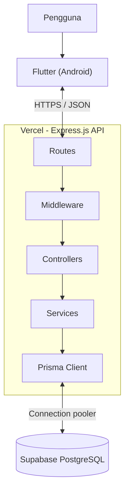
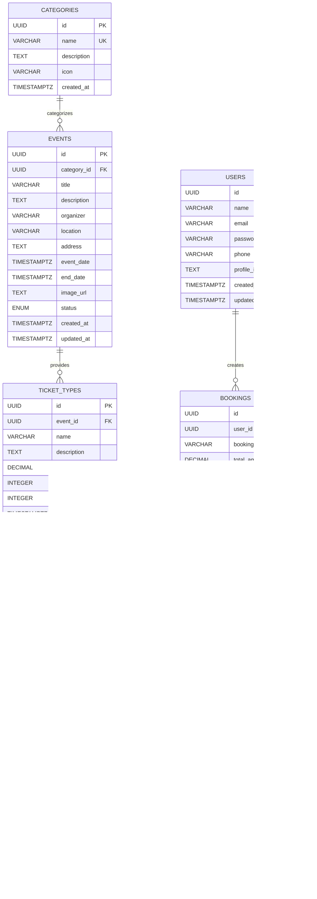

# PRODUCT REQUIREMENTS DOCUMENT (PRD)
# TIKETKITA
## Aplikasi Pemesanan dan Manajemen Tiket Acara Berbasis Mobile

| Informasi | Keterangan |
|---|---|
| Nama Produk | TiketKita |
| Jenis Produk | Aplikasi pemesanan tiket acara berbasis mobile |
| Versi Dokumen | **2.0** (konsolidasi PRD v1.0 + Addendum v1.1 + Addendum v1.2) |
| Tanggal | 17 November 2026 |
| Konteks | Tugas Akhir Praktikum Pemrograman Perangkat Bergerak (PPB) 2026 |
| Platform | Android |
| Frontend | Flutter (Dart) |
| Backend | Node.js 22 LTS + Express.js 5 (JavaScript, ES Modules) |
| Database | PostgreSQL di Supabase (hanya sebagai host database) |
| ORM | Prisma ORM |
| Hosting API | Vercel |
| Arsitektur | Client-Server dengan REST API |

**Dokumen ini berdiri sendiri dan menggantikan seluruh versi sebelumnya.** Jika ada perbedaan dengan PRD v1.0 atau addendum, dokumen inilah yang berlaku.

---

# DAFTAR ISI

1. Pendahuluan
2. Gambaran Umum Produk
3. Ruang Lingkup
4. Target Pengguna dan Hak Akses
5. Decision Log
6. Kebutuhan Fungsional
7. Layar dan Navigasi
8. Alur Proses Bisnis
9. Arsitektur Sistem
10. Tech Stack, Dependensi, dan Lingkungan
11. Struktur Proyek
12. Perancangan Database
13. Aturan Bisnis dan Transaksi
14. Rancangan REST API
15. Kebutuhan Nonfungsional dan Keamanan
16. Penanganan Kesalahan
17. Spesifikasi Seed Data
18. Strategi Pengujian
19. Deployment, Postman, dan APK
20. Kriteria Keberhasilan
21. Rencana Pengembangan dan Jadwal
22. Pembagian Tugas dan Penanganan Ambiguitas
23. Batasan dan Asumsi
24. Pengembangan Lanjutan
- Lampiran A: Model Prisma
- Lampiran B: Checklist RLS (tahap akhir)

---

# 1. PENDAHULUAN

## 1.1 Latar Belakang

Informasi acara seperti seminar, konser, workshop, kompetisi, dan festival tersebar di banyak platform. Calon peserta harus mencari informasi, memeriksa jadwal, membandingkan harga, memesan, dan menyimpan bukti pembelian secara terpisah.

TiketKita mengintegrasikan pencarian acara, pemesanan tiket, simulasi pembayaran, dan penerbitan tiket digital dalam satu aplikasi mobile. Komunikasi antara aplikasi dan backend memakai REST API sehingga pemrosesan data dan aturan bisnis tidak dilakukan langsung oleh aplikasi mobile.

## 1.2 Deskripsi Produk

TiketKita menyediakan layanan pencarian dan pemesanan tiket untuk acara berkategori: Seminar, Musik, Workshop, Kompetisi, dan Festival. Setiap acara memiliki judul, deskripsi, penyelenggara, kategori, lokasi, jadwal, poster, dan pilihan jenis tiket.

Pengguna memilih jenis dan jumlah tiket, membuat pemesanan, menyelesaikan pembayaran simulasi, lalu memperoleh tiket digital berkode QR di halaman My Tickets.

## 1.3 Identitas Produk

| Elemen | Deskripsi |
|---|---|
| Nama | TiketKita |
| Tagline | Temukan Acara, Pesan Tiket, Nikmati Momen |
| Target platform | Android |
| Target pengguna | Mahasiswa dan masyarakat umum |
| Model transaksi | Pemesanan tiket dengan simulasi pembayaran |
| Bahasa antarmuka | Bahasa Indonesia |

## 1.4 Ketentuan Tugas Akhir yang Harus Dipenuhi

| No | Ketentuan | Pemenuhan pada TiketKita |
|---|---|---|
| 1 | Menggunakan API buatan sendiri sesuai Modul 1 | Express 5 dengan struktur routes, controllers, services (+ Prisma sebagai lapisan model). Database Supabase, pengujian Postman, deploy Vercel. |
| 2 | Bottom Navigation Bar | 4 tab: Home, Explore, My Tickets, Profile |
| 3 | Minimal 5 halaman | 16 layar (bagian 7.1) |
| 4 | Minimal 2 halaman utama berisi list, item dapat diklik ke detail | Explore → Event Detail. My Tickets: sub-tab Tiket → Ticket Detail, sub-tab Pesanan → Booking Detail. Home → Event Detail. |
| 5 | Halaman Profile/About | Tab Profile dan layar About |
| 6 | Source code di GitHub | Satu repositori (monorepo), link dicantumkan pada kolom GitHub |
| 7 | Judul unik per platform | Judul "TiketKita" sudah terdaftar pada kolom Flutter |
| - | Nilai tambah APK | Bagian 19.3 |
| - | Asistensi minimal 1 kali, responsi 25-28 November 2026 | Dilakukan pemilik produk (bagian 22) |

---

# 2. GAMBARAN UMUM PRODUK

## 2.1 Konsep

TiketKita berfungsi sebagai perantara antara informasi acara dan calon peserta. Pada versi pertama tidak ada layanan administrasi untuk penyelenggara. Data acara diisi lewat seed script. Pengguna hanya berperan sebagai pencari dan pembeli tiket.

## 2.2 Karakteristik

1. Mobile dengan Flutter.
2. REST API buatan sendiri.
3. Autentikasi pengguna dengan JWT.
4. Pencarian dan filter acara.
5. Pemesanan beberapa tiket dalam satu transaksi (satu acara per transaksi).
6. Simulasi pembayaran.
7. Tiket digital dengan QR Code.
8. Riwayat pemesanan tersimpan di database.
9. Frontend, backend, dan database terpisah.
10. Aplikasi dapat dijelajahi tanpa login.

## 2.3 Tujuan Produk

1. Mempermudah pengguna menemukan acara.
2. Menyediakan informasi acara terpusat.
3. Mempermudah pemesanan tiket.
4. Menyediakan simulasi transaksi pembayaran.
5. Menghasilkan tiket digital yang dapat diakses kembali.
6. Menerapkan komunikasi client-server dengan REST API.
7. Menerapkan pengelolaan basis data relasional.
8. Menerapkan autentikasi dan pembatasan akses.

---

# 3. RUANG LINGKUP

## 3.1 Ruang Lingkup MVP

| No | Modul | Fitur | Prioritas |
|---|---|---|---|
| 1 | Authentication | Registrasi dan login | P0 |
| 2 | User | Melihat dan mengubah profil | P1 |
| 3 | Home | Acara unggulan dan acara terdekat | P0 |
| 4 | Event | Daftar acara | P0 |
| 5 | Event | Pencarian acara | P0 |
| 6 | Event | Filter kategori | P1 |
| 7 | Event | Detail acara | P0 |
| 8 | Ticket Type | Jenis dan harga tiket | P0 |
| 9 | Booking | Membuat pemesanan | P0 |
| 10 | Booking | Riwayat dan detail pemesanan | P0 |
| 11 | Booking | Membatalkan pemesanan PENDING | P0 |
| 12 | Payment | Simulasi pembayaran | P0 |
| 13 | Ticket | Penerbitan tiket digital | P0 |
| 14 | Ticket | Daftar, detail, dan QR Code | P0 |
| 15 | Profile | Informasi akun dan edit profil | P1 |
| 16 | About | Informasi aplikasi | P1 |
| 17 | Navigation | Bottom Navigation Bar | P0 |
| 18 | Deployment | Deploy API ke Vercel, koleksi Postman | P1 |
| 19 | Distribusi | Build APK | P2 |

P0 = wajib agar alur utama berjalan. P1 = pendukung, dikerjakan setelah P0. P2 = tambahan di luar MVP inti.

## 3.2 Di Luar Ruang Lingkup MVP

1. Payment gateway dan pembayaran uang sungguhan.
2. Dashboard administrasi.
3. Pembuatan dan pengelolaan acara oleh penyelenggara.
4. Pemindaian QR Code untuk validasi masuk acara.
5. Refund.
6. Push notification.
7. Chat pengguna dan penyelenggara.
8. Rekomendasi berbasis AI.
9. Ulasan dan rating.
10. Upload file (foto profil hanya berupa URL).
11. Rate limiting, refresh token.
12. Row Level Security Supabase (ditunda, lihat 15.4 dan Lampiran B).

---

# 4. TARGET PENGGUNA DAN HAK AKSES

Target: **mahasiswa** (seminar, workshop, kompetisi, konferensi) dan **masyarakat umum** (konser, festival, pameran).

Hanya ada satu jenis akun: pengguna umum. Tidak ada role Admin atau Organizer.

| Aktivitas | Tamu (belum login) | Pengguna login |
|---|---|---|
| Melihat Home, Explore, Detail acara | Ya | Ya |
| Registrasi dan login | Ya | - |
| Membuat pemesanan | Tidak (diminta login) | Ya |
| Pembayaran simulasi | Tidak | Ya |
| Melihat riwayat pemesanan dan tiket | Tidak | Ya (milik sendiri) |
| Mengubah profil | Tidak | Ya |
| Mengelola acara | Tidak | Tidak |
| Mengakses data pengguna lain | Tidak | Tidak |

---

# 5. DECISION LOG

Status **Dikonfirmasi** = diputuskan pemilik produk. **Default** = usulan yang dipakai sampai diubah pemilik produk. Setiap perubahan keputusan harus dicatat di `DECISIONS.md`.

| ID | Keputusan | Nilai | Status |
|---|---|---|---|
| D-01 | Simulasi pembayaran | Selalu SUCCESS. Tanpa parameter `simulateResult`. Status `FAILED` disiapkan di enum tetapi tidak dapat dicapai pada MVP. | Dikonfirmasi |
| D-02 | Batas waktu pembayaran | 15 menit sejak booking dibuat (`BOOKING_EXPIRY_MINUTES=15`) | Dikonfirmasi |
| D-03 | Akses tamu | Aplikasi dapat dijelajahi tanpa login. Login diminta saat "Pesan Tiket", membuka tab My Tickets, dan tab Profile. | Dikonfirmasi |
| D-04 | Isi booking | Satu booking hanya berisi tiket dari **satu acara**. Item beda acara ditolak 422. | Dikonfirmasi |
| D-05 | Kedaluwarsa booking | Lazy expiry tanpa scheduler (13.6) | Default |
| D-06 | Format JSON | Key `camelCase`. Waktu ISO 8601 UTC. Nominal uang berupa number. | Default |
| D-07 | Akses data pengguna lain | Dijawab **404** (bukan 403) | Default |
| D-08 | Registrasi | `POST /auth/register` mengembalikan data user. Flutter langsung login sesudahnya. | Default |
| D-09 | Password | Minimal 8 karakter, minimal 1 huruf dan 1 angka | Default |
| D-10 | Telepon | Wajib saat registrasi, format Indonesia (14.5), disimpan apa adanya | Default |
| D-11 | Cost bcrypt | 10 (`BCRYPT_ROUNDS`) | Default |
| D-12 | Foto profil | Hanya URL (opsional). Kosong: avatar inisial nama. | Default |
| D-13 | Acara yang dapat dipesan | `status = UPCOMING` dan `eventDate > sekarang` | Default |
| D-14 | Acara di Explore | `UPCOMING` dan `ONGOING`. `COMPLETED`/`CANCELLED` hanya jika parameter `status` eksplisit. Detail via ID selalu dapat dibuka. | Default |
| D-15 | Batas pemesanan | Maks 5 item per booking, 1-10 tiket per item, total maks 10 tiket | Default |
| D-16 | `ticketTypeId` ganda dalam satu request | Ditolak 422 | Default |
| D-17 | Pagination | `page` default 1. `limit` default 10, maks 50. | Default |
| D-18 | State management Flutter | `provider` (ChangeNotifier) hanya untuk sesi autentikasi. Layar lain `setState` + `FutureBuilder`. | Default |
| D-19 | Routing Flutter | `Navigator` bawaan dengan `onGenerateRoute` | Default |
| D-20 | Versi Express | Express 5 | Default |
| D-21 | Framework tes backend | Vitest + supertest | Default |
| D-22 | Pembuatan baris `payments` | Dibuat saat `POST /payments/:bookingId` | Default |
| D-23 | Di luar MVP | Rate limiting, refresh token, upload file | Default |
| D-24 | Database | PostgreSQL di **Supabase** sebagai host. Akses data lewat **Prisma**, bukan `supabase-js`. | Default (jika asisten mewajibkan `supabase-js`, desain transaksi harus diubah) |
| D-25 | Row Level Security | **Ditunda.** Agent tidak boleh mengaktifkan RLS atau mengubah pengaturan dashboard Supabase. | Dikonfirmasi |
| D-26 | Docker | Tidak dipakai | Dikonfirmasi |
| D-27 | Versi package | Bebas. Pasang versi stabil terbaru, kunci lockfile, catat di `DECISIONS.md`. | Dikonfirmasi |
| D-28 | Repositori | Monorepo: `backend/` dan `frontend/` | Default |
| D-29 | Database tes | Schema `test` pada project Supabase yang sama | Default |
| D-30 | URL API build rilis/APK | URL Vercel (HTTPS) lewat `--dart-define` | Default |
| D-31 | Pengaman seed | Wajib `SEED_CONFIRM=yes` (17.1) | Default |

---

# 6. KEBUTUHAN FUNGSIONAL

## 6.1 Authentication

**FR-01 Registrasi.** Pengguna membuat akun dengan nama lengkap, email, nomor telepon, dan password (konfirmasi password divalidasi di Flutter).
- Nama 2-100 karakter. Email format valid, unik, huruf kecil, maks 150. Telepon sesuai D-10. Password sesuai D-09.
- Password di-hash dengan bcrypt sebelum disimpan.
- Email duplikat ditolak (409).

**FR-02 Login.** Pengguna masuk dengan email dan password.
- Backend memverifikasi kredensial dan menghasilkan JWT.
- Gagal login: pesan sama untuk email tidak ada dan password salah.
- Flutter menyimpan token di secure storage.

**FR-03 Autentikasi sesi.** Setiap request privat membawa `Authorization: Bearer <token>`. Token tidak valid, kedaluwarsa, atau tidak ada ditolak (401). Pada 401 Flutter menghapus token dan mengarahkan ke Login.

## 6.2 User

**FR-04 Melihat profil.** Nama, email, telepon, foto profil (jika ada).

**FR-05 Memperbarui profil.** Pengguna dapat mengubah nama, telepon, dan URL foto profil. Email tidak dapat diubah.

## 6.3 Event

**FR-06 Daftar acara.** Dari database dengan pagination. Kartu acara: poster, judul, kategori, tanggal, lokasi, harga mulai dari harga terendah (atau "Gratis"), dan penanda "Habis" jika seluruh jenis tiket stok 0.

**FR-07 Acara unggulan.** Maks 5 acara `UPCOMING` dengan jadwal terdekat yang belum lewat.

**FR-08 Pencarian.** Berdasarkan judul atau nama penyelenggara (contains, tidak sensitif huruf besar-kecil).

**FR-09 Filter kategori.**

**FR-10 Detail acara.** Poster, judul, kategori, penyelenggara, deskripsi, tanggal dan waktu, lokasi, alamat, jenis tiket (harga, stok), dan status dapat tidaknya dipesan (`canBook`). Acara tidak ditemukan: 404.

## 6.4 Booking

**FR-11 Memilih tiket.** Jumlah > 0, tidak melebihi stok, batas D-15. Harga diambil dari database. Client tidak mengirim harga.

**FR-12 Membuat pemesanan.** Menyimpan pengguna, kode booking, total, status `PENDING`, detail (jenis tiket, jumlah, harga satuan, subtotal), dan `expiresAt`. Stok berkurang dalam transaksi yang sama.

**FR-13 Riwayat pemesanan.** Kode booking, nama acara, tanggal transaksi, jumlah tiket, total, status. Terbaru lebih dahulu.

**FR-14 Pembatalan.** Hanya booking `PENDING`. `PAID`, `CANCELLED`, dan `EXPIRED` tidak dapat dibatalkan (409). Stok dikembalikan secara atomik.

## 6.5 Payment

**FR-15 Simulasi pembayaran.** Metode: `BANK_TRANSFER`, `E_WALLET`, `QRIS`.
- Backend memeriksa kepemilikan dan status booking, lalu memakai `totalAmount` dari database sebagai nominal.
- Hasil selalu sukses (D-01): payment `SUCCESS`, booking `PAID`, tiket diterbitkan.
- Tidak terhubung ke layanan keuangan eksternal.

## 6.6 Ticket

**FR-16 Penerbitan tiket.** Satu tiket per unit `quantity`, dengan kode unik, QR token unik, status `ACTIVE`.

**FR-17 Daftar tiket.** Halaman My Tickets, sub-tab Tiket.

**FR-18 Detail tiket.** Nama acara, nama pemilik, kode tiket, kode booking, jenis tiket, tanggal acara, lokasi, QR Code, status.

**FR-19 QR Code.** Dibuat di Flutter (`qr_flutter`) dengan isi string `qrToken` dari backend. Validasi di pintu masuk belum termasuk MVP.

## 6.7 Navigasi dan Informasi

**FR-20 Bottom Navigation Bar.** Home, Explore, My Tickets, Profile.

**FR-21 Logout.** Token dihapus, stack navigasi dikosongkan, pengguna kembali ke mode tamu.

**FR-22 About.** Nama, versi, deskripsi, identitas pengembang.

---

# 7. LAYAR DAN NAVIGASI

## 7.1 Daftar layar (16)

| No | Layar | Keterangan |
|---|---|---|
| 1 | Splash | Membaca token dari secure storage, lalu **selalu** menuju MainShell (D-03) |
| 2 | Login | Email, password, tombol Login, tombol ke Register. Parameter opsional `redirectTo`. |
| 3 | Register | Nama, email, telepon, password, konfirmasi password. Sukses: otomatis login. |
| 4 | MainShell | Bottom Navigation Bar dengan 4 tab |
| 5 | Home (tab) | Sapaan ("Halo, {nama}" atau "Halo, Tamu"), search bar (ketuk = pindah ke Explore dengan fokus), banner acara unggulan, daftar kategori, daftar acara terdekat |
| 6 | Explore (tab) | Search bar (debounce 400 ms), chip kategori (termasuk "Semua"), daftar acara dengan infinite scroll, empty state |
| 7 | My Tickets (tab) | Dua sub-tab: **Tiket** (tiket terbit) dan **Pesanan** (riwayat booking). Tamu: empty state dengan tombol Login. |
| 8 | Profile (tab) | Avatar, nama, email, telepon, menu Edit Profil, About, Logout. Tamu: empty state dengan tombol Login. |
| 9 | Event Detail | Poster, info acara, jenis tiket dengan stepper jumlah (0-10, dibatasi stok), tombol "Pesan Tiket" |
| 10 | Checkout | Ringkasan acara, item, harga satuan, subtotal, total, tombol "Lanjutkan" |
| 11 | Payment | Kode booking, total, hitung mundur sisa waktu, pilihan metode, tombol "Bayar" |
| 12 | Payment Success | Ikon sukses, kode booking, tombol "Lihat Tiket" dan "Kembali ke Beranda" |
| 13 | Booking Detail | Kode, status, acara, item, total, waktu dibuat, aksi sesuai status |
| 14 | Ticket Detail | Info acara, pemilik, jenis tiket, kode tiket, kode booking, status, QR Code |
| 15 | Edit Profile | Nama, telepon, URL foto (opsional). Email read-only. |
| 16 | About | Logo, nama, versi, deskripsi, identitas pengembang |

## 7.2 Daftar tiket vs pesanan

- Sub-tab **Tiket**: daftar datar tiket individual (`GET /tickets`), diurutkan `issuedAt` terbaru. Kartu: judul acara, tanggal, jenis tiket, kode tiket, badge status. Ketuk membuka Ticket Detail.
- Sub-tab **Pesanan**: daftar booking (`GET /bookings`), terbaru dahulu. Kartu: kode booking, judul acara, tanggal transaksi, jumlah tiket, total, badge status. Ketuk membuka Booking Detail.

## 7.3 Aksi pada Booking Detail

| Status | Tombol |
|---|---|
| PENDING (belum kedaluwarsa) | "Bayar Sekarang" (ke Payment) dan "Batalkan Pemesanan" (dialog konfirmasi) |
| PAID | "Lihat Tiket" (ke My Tickets, sub-tab Tiket) |
| CANCELLED / EXPIRED | Tanpa aksi |

Untuk PENDING tampilkan hitung mundur. Saat habis, muat ulang booking dari server (server yang menentukan EXPIRED).

## 7.4 Alur navigasi

- **Pesan Tiket**: Event Detail → (belum login: Login lalu kembali ke Event Detail dengan pilihan jumlah dipertahankan) → Checkout → `POST /bookings` → Checkout diganti Payment (`pushReplacement`).
- **Back dari Payment** sebelum membayar: kembali ke Event Detail. Booking tetap PENDING dan dapat dibayar dari My Tickets → Pesanan. Tampilkan snackbar "Pesanan tersimpan, selesaikan pembayaran dalam 15 menit."
- **Bayar sukses**: Payment → Payment Success. "Lihat Tiket" mengosongkan stack menuju MainShell tab My Tickets sub-tab Tiket. Tombol Back sistem = "Kembali ke Beranda".
- **Batal sukses**: kembali ke daftar Pesanan, snackbar "Pemesanan dibatalkan", daftar dimuat ulang.
- **Logout**: hapus token, kosongkan stack, menuju MainShell sebagai tamu.
- **401 pada endpoint privat**: hapus token, kosongkan stack menuju Login, pesan "Sesi berakhir, silakan masuk kembali".
- **Acara tidak dapat dipesan** (`canBook = false`): tombol "Pesan Tiket" nonaktif dengan label sesuai status ("Acara Dibatalkan", "Acara Selesai", "Acara Sedang Berlangsung").
- **Jenis tiket stok 0**: stepper nonaktif, label "Habis".
- **Error jaringan**: "Tidak dapat terhubung ke server. Periksa koneksi Anda." dengan tombol "Coba Lagi".

## 7.5 Panduan UI

| Elemen | Nilai |
|---|---|
| Material | Material 3, `useMaterial3: true`, `ColorScheme.fromSeed` |
| Warna utama / aksen | `#4F46E5` (indigo) / `#F59E0B` (amber) |
| Latar | `#F8FAFC`, kartu putih sudut 16 dp |
| Sukses / Error | `#16A34A` / `#DC2626` |
| Font | Bawaan Material (Roboto) |
| Logo | Placeholder: `Icons.confirmation_number_rounded` berwarna utama + teks "TiketKita" |
| Badge booking | PENDING amber, PAID hijau, CANCELLED merah muda, EXPIRED abu-abu |
| Badge tiket | ACTIVE hijau, USED abu-abu, CANCELLED merah muda |
| Format harga | `Rp 150.000` (`intl`, `id_ID`). Harga 0 tampil "Gratis". |
| Loading / Empty | `CircularProgressIndicator` atau skeleton daftar. Empty state: ikon, teks Indonesia, tombol aksi bila relevan. |

Tata letak ringkas:
- **Home**: header sapaan, search bar, carousel banner acara unggulan (poster, judul, tanggal), baris kategori (ikon bulat + nama), daftar vertikal acara terdekat.
- **Explore**: search bar, chip kategori yang dapat digulir horizontal, daftar kartu acara.
- **Kartu acara**: poster 16:9, judul (maks 2 baris), kategori, tanggal, lokasi, "Mulai dari Rp X" atau "Gratis" atau badge "Habis".
- **Event Detail**: poster lebar penuh, judul, chip kategori, penyelenggara, tanggal dan lokasi berikon, deskripsi, bagian "Pilih Tiket" (kartu per jenis tiket: harga, sisa stok, stepper), bilah bawah lekat berisi total dan tombol "Pesan Tiket".
- **Ticket Detail**: kartu bergaya tiket, QR Code (min. 220 dp, latar putih) di tengah, kode tiket di bawahnya.

---

# 8. ALUR PROSES BISNIS

## 8.1 Registrasi dan login
1. Pengguna mengisi formulir registrasi. Flutter mengirim data ke backend.
2. Backend memvalidasi, melakukan hash bcrypt, menyimpan user, lalu mengembalikan data user.
3. Flutter memanggil login. Backend memverifikasi kredensial dan mengembalikan JWT.
4. Flutter menyimpan token di secure storage dan membuka MainShell (atau layar asal bila ada `redirectTo`).

## 8.2 Pencarian acara
1. Pengguna membuka Home atau Explore. Flutter meminta daftar acara.
2. Pengguna memasukkan kata kunci atau memilih kategori. Flutter mengirim parameter, backend memfilter.
3. Flutter menampilkan hasil. Pengguna memilih acara dan membuka Event Detail.

## 8.3 Pemesanan tiket
1. Pengguna memilih jenis dan jumlah tiket di Event Detail. Jika belum login, diarahkan ke Login.
2. Flutter mengirim `POST /bookings`.
3. Backend (satu transaksi): memeriksa input, acara, dan stok, mengambil harga dari database, menghitung total, mengurangi stok, membuat booking dan booking detail.
4. Backend mengembalikan ringkasan booking. Flutter membuka Payment.

## 8.4 Pembayaran
1. Pengguna memilih metode pembayaran lalu menekan "Bayar". Tombol dinonaktifkan selama request.
2. Backend memproses sesuai 13.4 (satu transaksi): payment SUCCESS, booking PAID, tiket terbit.
3. Flutter menampilkan Payment Success. Tiket tersedia di My Tickets.

## 8.5 Pembatalan
1. Pengguna membuka Booking Detail dan memilih "Batalkan Pemesanan".
2. Backend memverifikasi kepemilikan dan status PENDING, mengubah status ke CANCELLED, dan mengembalikan stok dalam satu transaksi.
3. Flutter menampilkan konfirmasi.

---

# 9. ARSITEKTUR SISTEM

## 9.1 Model arsitektur

Client-Server dengan tiga komponen: Flutter (client), Express.js di Vercel (backend), dan PostgreSQL di Supabase (database). Flutter **tidak** mengakses database maupun Supabase secara langsung. Kunci Supabase tidak boleh ada di aplikasi Flutter maupun repositori.



## 9.2 Komponen

**Flutter**: antarmuka, navigasi, pemanggilan API, penyimpanan token aman, QR Code, loading dan error. Tidak menentukan harga transaksi.

**Express.js**: menerima request, validasi autentikasi dan input, logika bisnis (harga, stok, booking, pembayaran, penerbitan tiket), akses database.

**PostgreSQL (Supabase)**: akun, kategori, acara, jenis tiket, booking, detail booking, pembayaran, tiket.

**Prisma ORM**: definisi model, relasi, query (berparameter), transaksi, migration, Prisma Client.

## 9.3 Arsitektur backend

- **Routes**: memetakan endpoint ke middleware dan controller.
- **Middleware**: autentikasi JWT, validasi request (Zod), CORS, error handling, logging.
- **Controllers**: mengelola request/response HTTP, tanpa query database.
- **Services**: logika bisnis dan transaksi.
- **Prisma**: seluruh operasi database. Tidak memakai `supabase-js`.

Pemetaan terhadap Modul 1: routes = router, controller = controller, service + Prisma = model.

## 9.4 Alur JWT
1. Backend memverifikasi password dengan bcrypt dan membuat JWT (HS256, payload `{ "sub": "<userId>" }`, masa berlaku `JWT_EXPIRES_IN`).
2. Flutter menyimpan token di secure storage dan menyertakannya pada request privat.
3. Middleware memverifikasi token. Jika valid, `userId` tersedia untuk controller.

## 9.5 Koneksi database
- `DATABASE_URL`: koneksi runtime via **connection pooler** Supabase (mode transaction, port 6543) dengan `pgbouncer=true`. Dipakai lokal dan Vercel.
- `DIRECT_URL`: migrasi dan tes. Direct connection, atau **session pooler** (port 5432 pada host pooler) bila jaringan tidak mendukung IPv6. Kedua string ada pada tombol **Connect** di dashboard Supabase.
- Kata sandi database dengan karakter khusus harus di-URL-encode.
- Lokasi konfigurasi `url` dan `directUrl` dapat berbeda antarversi mayor Prisma. Ikuti dokumentasi resmi versi terpasang.
- Migrasi dijalankan dari komputer lokal (`prisma migrate deploy`, atau `migrate dev` saat pengembangan), **tidak** saat build Vercel.
- Jika `migrate dev` bermasalah pada shadow database di Supabase, catat di `DECISIONS.md` dan pakai solusi dari dokumentasi Prisma. Jangan mengubah desain tabel untuk menghindarinya.
- `prisma.$transaction` interaktif tetap dipakai untuk logika di bagian 13.

---

# 10. TECH STACK, DEPENDENSI, DAN LINGKUNGAN

## 10.1 Frontend

| Teknologi | Fungsi |
|---|---|
| Flutter + Dart | Framework dan bahasa |
| Material 3 | Komponen UI |
| `http` | REST API |
| `flutter_secure_storage` | Penyimpanan token |
| `qr_flutter` | QR Code |
| `intl` | Format tanggal dan angka |
| `provider` | State sesi autentikasi (D-18) |

```bash
flutter pub add http flutter_secure_storage qr_flutter intl provider
```

## 10.2 Backend

| Package | Fungsi |
|---|---|
| express | HTTP server dan routing (Express 5) |
| @prisma/client | Prisma Client |
| bcryptjs | Hash password |
| jsonwebtoken | JWT |
| cors | CORS |
| dotenv | Environment variable |
| zod | Validasi request |
| helmet | HTTP security headers |
| morgan | Logging |

DevDependencies: `prisma`, `nodemon`, `vitest`, `supertest`.

```bash
npm install express @prisma/client bcryptjs jsonwebtoken cors dotenv zod helmet morgan
npm install -D prisma nodemon vitest supertest
```

Modul bawaan Node.js: `crypto`, `path`, `url`, `fs`.

Aturan versi (D-27): pasang versi stabil terbaru, kunci dengan `package-lock.json` dan `pubspec.lock`, catat versi terpasang di `DECISIONS.md`. `prisma` dan `@prisma/client` harus versi mayor yang sama. Jangan mencampur sintaks Zod versi lama dan baru.

## 10.3 Lingkungan pengembangan

| Komponen | Kebutuhan |
|---|---|
| OS | Windows, Linux, atau macOS |
| Node.js | 22 LTS |
| Flutter SDK | Stable channel (Dart mengikuti) |
| Android Studio | Android SDK dan emulator |
| JDK | Kompatibel dengan Android Gradle Plugin |
| Database | Project Supabase (tanpa PostgreSQL lokal dan tanpa Docker) |
| Git, GitHub | Version control dan repositori |
| Postman | Pengujian API |
| VS Code / Android Studio | Editor |

## 10.4 Konfigurasi backend

`.env.example`:

```env
PORT=3000
NODE_ENV=development

# Runtime: Supabase connection pooler (transaction mode)
DATABASE_URL="postgresql://postgres.<PROJECT_REF>:<PASSWORD>@<POOLER_HOST>:6543/postgres?pgbouncer=true"
# Migrasi dan tes: direct connection atau session pooler
DIRECT_URL="postgresql://postgres.<PROJECT_REF>:<PASSWORD>@<POOLER_HOST>:5432/postgres"

JWT_SECRET="ganti_dengan_string_acak_minimal_32_karakter"
JWT_EXPIRES_IN="1d"
BCRYPT_ROUNDS=10
BOOKING_EXPIRY_MINUTES=15
CORS_ORIGIN="*"
```

`.env.test.example` (file `.env.test` tidak di-commit):

```env
NODE_ENV=test
DATABASE_URL="<sama dengan DIRECT_URL>?schema=test"
DIRECT_URL="<DIRECT_URL>?schema=test"
JWT_SECRET="secret_khusus_tes_minimal_32_karakter"
JWT_EXPIRES_IN="1d"
BCRYPT_ROUNDS=4
BOOKING_EXPIRY_MINUTES=15
```

`.gitignore` wajib memuat `.env`, `.env.test`, `node_modules`, `.vercel`.

## 10.5 `package.json` (bagian penting)

```json
{
  "type": "module",
  "engines": { "node": "22.x" },
  "scripts": {
    "dev": "nodemon src/server.js",
    "start": "node src/server.js",
    "postinstall": "prisma generate",
    "prisma:migrate": "prisma migrate dev",
    "prisma:deploy": "prisma migrate deploy",
    "prisma:studio": "prisma studio",
    "db:seed": "node prisma/seed.js",
    "test": "vitest run"
  }
}
```

## 10.6 Pengaturan backend
- Server mendengarkan di `0.0.0.0`.
- `src/app.js` membuat dan mengekspor instance Express. `src/server.js` memanggil `listen` hanya bila tidak di Vercel (`if (!process.env.VERCEL)`) dan mengekspor `app` sebagai default export.
- Urutan middleware: `helmet`, `cors`, `morgan`, `express.json`, routes `/api/v1`, handler 404 (JSON standar), error middleware.
- Error middleware: Zod → 422, error domain (`NotFoundError`, `ConflictError`, `UnauthorizedError`) → kode sesuai, Prisma `P2002` (unique) → 409, lainnya → 500 dengan pesan generik (detail hanya di log).
- `GET /health` → `{ "status": "ok" }` dan `GET /` → nama dan versi API (di luar `/api/v1`).

## 10.7 Pengaturan Flutter dan Android
- URL API dari `--dart-define=API_BASE_URL=...`, default `http://10.0.2.2:3000/api/v1` (emulator). `localhost` tidak dapat dipakai dari emulator. Perangkat fisik/rilis memakai URL Vercel (HTTPS).
- HTTP non-HTTPS pada pengembangan: `android:usesCleartextTraffic="true"` hanya di `android/app/src/debug/AndroidManifest.xml`. Pastikan `<uses-permission android:name="android.permission.INTERNET"/>` ada di manifest utama.
- `flutter_secure_storage` membutuhkan `minSdk` sesuai persyaratan versi terpasang (umumnya 23).
- Satu `ApiClient` terpusat di `core/network`: menyisipkan header Authorization, timeout 15 detik, menguraikan envelope respons, memetakan 401 ke event "sesi berakhir".
- Model Flutter memakai `fromJson` manual (tanpa code generation).
- `initializeDateFormatting('id_ID')` di `main()`. Waktu dari server dikonversi `.toLocal()` dan ditampilkan seperti `Sab, 12 Des 2026 • 10.00 WIB`.
- Gambar jaringan wajib memiliki `errorBuilder` dan placeholder.

---

# 11. STRUKTUR PROYEK

## 11.1 Repositori (monorepo, D-28)

```text
tiketkita/
├── README.md              (ringkasan, cara menjalankan, link API, tautan README tiap folder)
├── DECISIONS.md
├── backend/
│   ├── prisma/
│   │   ├── schema.prisma
│   │   ├── seed.js
│   │   └── migrations/
│   ├── src/
│   │   ├── config/        (database.js, env.js)
│   │   ├── middlewares/   (auth, error, validate)
│   │   ├── modules/       (auth, users, categories, events, bookings, payments, tickets)
│   │   │                  (tiap modul: routes, controller, service, validation)
│   │   ├── routes/index.js
│   │   ├── utils/         (api-response.js, generate-code.js, serializer.js, errors.js)
│   │   ├── app.js
│   │   └── server.js
│   ├── tests/
│   ├── postman/
│   ├── vercel.json
│   ├── .env.example
│   ├── .env.test.example
│   ├── .gitignore
│   ├── package.json
│   └── README.md
└── frontend/
    ├── lib/
    │   ├── main.dart
    │   ├── core/          (constants, theme, network, storage)
    │   ├── models/        (user, category, event, ticket_type, booking, payment, ticket)
    │   ├── services/      (auth, event, booking, payment, ticket)
    │   ├── screens/       (auth, home, explore, event_detail, checkout, payment, bookings, tickets, profile)
    │   ├── widgets/       (event_card, category_item, ticket_card, booking_card, status_badge, bottom_navbar)
    │   └── routes/app_routes.dart
    ├── assets/            (images, icons)
    ├── pubspec.yaml
    └── README.md
```

Struktur dapat disederhanakan selama pemisahan routes, controllers, services (backend) dan tanggung jawab komponen (Flutter) tetap jelas.

---

# 12. PERANCANGAN DATABASE

## 12.1 Pendekatan dan konvensi

| Aspek | Keputusan |
|---|---|
| DBMS | PostgreSQL (Supabase) |
| ORM | Prisma |
| Primary key / foreign key | UUID |
| String pendek / teks panjang | VARCHAR / TEXT |
| Nominal uang | DECIMAL(12,2) |
| Jumlah tiket | INTEGER |
| Tanggal dan waktu | TIMESTAMPTZ (UTC) |
| Status | ENUM |
| Password | Hash bcrypt |

1. Tabel snake_case plural. Atribut snake_case. Model Prisma PascalCase singular.
2. FK berakhiran `_id`.
3. Semua relasi FK: `onDelete: Restrict`, `onUpdate: Cascade`.
4. Data transaksi tidak dihapus permanen untuk menjaga riwayat.

## 12.2 Delapan tabel

| No | Tabel | Fungsi |
|---|---|---|
| 1 | users | Akun pengguna |
| 2 | categories | Kategori acara |
| 3 | events | Informasi acara |
| 4 | ticket_types | Jenis tiket per acara |
| 5 | bookings | Transaksi pemesanan |
| 6 | booking_details | Rincian tiket per pemesanan |
| 7 | payments | Pembayaran |
| 8 | tickets | Tiket digital |

## 12.3 ERD



## 12.4 Relasi

- Users — Bookings: one-to-many.
- Categories — Events: one-to-many (satu acara satu kategori).
- Events — Ticket Types: one-to-many (Regular, VIP, Early Bird, dan seterusnya).
- Bookings — Booking Details: one-to-many.
- Ticket Types — Booking Details: one-to-many.
- Bookings — Payments: one-to-one (maksimal satu pembayaran per booking, opsional di sisi booking).
- Booking Details — Tickets: one-to-many.

Contoh: pengguna membeli tiga tiket Regular menghasilkan 1 baris `bookings`, 1 baris `booking_details` (quantity = 3), 1 baris `payments`, dan 3 baris `tickets` setelah pembayaran berhasil.

## 12.5 Spesifikasi tabel

**users**

| Atribut | Tipe | Constraint |
|---|---|---|
| id | UUID | PK |
| name | VARCHAR(100) | NOT NULL |
| email | VARCHAR(150) | UNIQUE, NOT NULL |
| password | VARCHAR(255) | NOT NULL (hash) |
| phone | VARCHAR(20) | NULL |
| profile_image | TEXT | NULL (URL) |
| created_at, updated_at | TIMESTAMPTZ | NOT NULL |

**categories**

| Atribut | Tipe | Constraint |
|---|---|---|
| id | UUID | PK |
| name | VARCHAR(100) | UNIQUE, NOT NULL |
| description | TEXT | NULL |
| icon | VARCHAR(100) | NULL (nama Material Icon snake_case) |
| created_at | TIMESTAMPTZ | NOT NULL |

**events**

| Atribut | Tipe | Constraint |
|---|---|---|
| id | UUID | PK |
| category_id | UUID | FK, NOT NULL |
| title | VARCHAR(200) | NOT NULL |
| description | TEXT | NOT NULL |
| organizer | VARCHAR(150) | NOT NULL |
| location | VARCHAR(255) | NOT NULL |
| address | TEXT | NULL |
| event_date | TIMESTAMPTZ | NOT NULL |
| end_date | TIMESTAMPTZ | NULL |
| image_url | TEXT | NULL |
| status | ENUM EventStatus | NOT NULL (`UPCOMING`, `ONGOING`, `COMPLETED`, `CANCELLED`) |
| created_at, updated_at | TIMESTAMPTZ | NOT NULL |

**ticket_types**

| Atribut | Tipe | Constraint |
|---|---|---|
| id | UUID | PK |
| event_id | UUID | FK, NOT NULL |
| name | VARCHAR(100) | NOT NULL |
| description | TEXT | NULL |
| price | DECIMAL(12,2) | NOT NULL |
| quota | INTEGER | NOT NULL |
| available_stock | INTEGER | NOT NULL |
| created_at, updated_at | TIMESTAMPTZ | NOT NULL |

Unik: (`event_id`, `name`). Check: lihat 12.6.

**bookings**

| Atribut | Tipe | Constraint |
|---|---|---|
| id | UUID | PK |
| user_id | UUID | FK, NOT NULL |
| booking_code | VARCHAR(30) | UNIQUE, NOT NULL |
| total_amount | DECIMAL(12,2) | NOT NULL |
| status | ENUM BookingStatus | NOT NULL (`PENDING`, `PAID`, `CANCELLED`, `EXPIRED`) |
| expires_at | TIMESTAMPTZ | NULL |
| created_at, updated_at | TIMESTAMPTZ | NOT NULL |

**booking_details**

| Atribut | Tipe | Constraint |
|---|---|---|
| id | UUID | PK |
| booking_id | UUID | FK, NOT NULL |
| ticket_type_id | UUID | FK, NOT NULL |
| quantity | INTEGER | NOT NULL |
| unit_price | DECIMAL(12,2) | NOT NULL (snapshot harga saat transaksi) |
| subtotal | DECIMAL(12,2) | NOT NULL |

**payments**

| Atribut | Tipe | Constraint |
|---|---|---|
| id | UUID | PK |
| booking_id | UUID | FK, UNIQUE, NOT NULL |
| payment_method | ENUM PaymentMethod | NOT NULL (`BANK_TRANSFER`, `E_WALLET`, `QRIS`) |
| amount | DECIMAL(12,2) | NOT NULL |
| status | ENUM PaymentStatus | NOT NULL (`PENDING`, `SUCCESS`, `FAILED`) |
| transaction_reference | VARCHAR(100) | UNIQUE, NULL |
| paid_at | TIMESTAMPTZ | NULL |
| created_at, updated_at | TIMESTAMPTZ | NOT NULL |

Satu booking hanya memiliki satu payment. Riwayat beberapa percobaan pembayaran belum disimpan.

**tickets**

| Atribut | Tipe | Constraint |
|---|---|---|
| id | UUID | PK |
| booking_detail_id | UUID | FK, NOT NULL |
| ticket_code | VARCHAR(40) | UNIQUE, NOT NULL |
| qr_token | VARCHAR(255) | UNIQUE, NOT NULL |
| status | ENUM TicketStatus | NOT NULL (`ACTIVE`, `USED`, `CANCELLED`) |
| issued_at | TIMESTAMPTZ | NOT NULL |
| used_at | TIMESTAMPTZ | NULL |

Status `USED` dan `CANCELLED` disiapkan untuk pengembangan lanjutan (tidak ada alur MVP yang memakainya).

## 12.6 Check constraint (SQL migration)

Prisma tidak merepresentasikan check constraint langsung. Buat migration dengan `prisma migrate dev --create-only --name add_check_constraints`, isi SQL berikut, lalu jalankan:

```sql
ALTER TABLE ticket_types ADD CONSTRAINT chk_ticket_types_price CHECK (price >= 0);
ALTER TABLE ticket_types ADD CONSTRAINT chk_ticket_types_quota CHECK (quota >= 0);
ALTER TABLE ticket_types ADD CONSTRAINT chk_ticket_types_stock CHECK (available_stock >= 0 AND available_stock <= quota);
ALTER TABLE bookings ADD CONSTRAINT chk_bookings_total CHECK (total_amount >= 0);
ALTER TABLE booking_details ADD CONSTRAINT chk_booking_details_qty CHECK (quantity > 0);
ALTER TABLE booking_details ADD CONSTRAINT chk_booking_details_price CHECK (unit_price >= 0 AND subtotal >= 0);
ALTER TABLE booking_details ADD CONSTRAINT chk_booking_details_subtotal CHECK (subtotal = quantity * unit_price);
ALTER TABLE payments ADD CONSTRAINT chk_payments_amount CHECK (amount >= 0);
```

Migration **tidak** boleh memuat `ENABLE ROW LEVEL SECURITY` (D-25).

## 12.7 Unique dan indeks

| Tabel | Unique |
|---|---|
| users | email |
| categories | name |
| ticket_types | event_id + name |
| bookings | booking_code |
| payments | booking_id, transaction_reference |
| tickets | ticket_code, qr_token |

| Tabel | Indeks |
|---|---|
| events | (category_id, event_date), (status, event_date) |
| ticket_types | (event_id) |
| bookings | (user_id, status), (created_at), (status, expires_at) |
| booking_details | (booking_id), (ticket_type_id) |
| tickets | (booking_detail_id) |

## 12.8 Penghapusan data

User, event, ticket type, booking, payment, dan ticket yang memiliki riwayat transaksi tidak dihapus permanen. Mekanisme soft delete dipertimbangkan pada pengembangan lanjutan.

---

# 13. ATURAN BISNIS DAN TRANSAKSI

## 13.1 Perhitungan harga

Dihitung di backend. `Subtotal = Quantity × Unit Price`. `Total Booking = Σ Subtotal`. `unitPrice` dibaca dari `ticket_types` dalam transaksi yang sama dan disimpan sebagai snapshot.

## 13.2 Format kode dan token

| Item | Format | Pembuatan |
|---|---|---|
| `booking_code` | `TK-YYYYMMDD-XXXXXX` (X dari `ABCDEFGHJKLMNPQRSTUVWXYZ23456789`) | `crypto.randomInt`. Tanggal UTC. Ulangi maks 5 kali bila tabrakan unique. |
| `ticket_code` | `TKT-XXXXXXXXXX` (10 karakter, alfabet sama) | Sama |
| `qr_token` | 64 karakter heksadesimal | `crypto.randomBytes(32).toString('hex')` |
| `transaction_reference` | `SIM-XXXXXXXXXXXX` (12 karakter, alfabet sama) | Sama |

Isi QR Code di Flutter = string `qrToken`.

## 13.3 Pembuatan booking dan stok (anti-overselling)

`POST /bookings` dalam satu `prisma.$transaction`. Pengurangan stok **wajib atomik** per jenis tiket:

```js
const r = await tx.ticketType.updateMany({
  where: { id: ticketTypeId, availableStock: { gte: quantity } },
  data: { availableStock: { decrement: quantity } },
});
if (r.count === 0) throw new ConflictError('Stok tiket tidak mencukupi');
```

Dilarang pola "baca stok lalu tulis nilai baru". Jika terjadi kegagalan, seluruh perubahan di-rollback.

## 13.4 Alur pembayaran (`POST /payments/:bookingId`)

Seluruhnya dalam satu transaksi:
1. Jalankan sweep kedaluwarsa untuk booking ini (13.6).
2. Muat booking milik pengguna. Tidak ada atau bukan milik pengguna: 404.
3. `PAID`: 409 "Pemesanan sudah dibayar". `CANCELLED`: 409 "Pemesanan telah dibatalkan". `EXPIRED`: 409 "Waktu pembayaran telah habis".
4. Nominal = `booking.totalAmount` dari database. Client tidak mengirim nominal.
5. Buat atau perbarui baris `payments`: `status = SUCCESS`, `paidAt = now`, `amount = totalAmount`, `transactionReference` baru (D-01, D-22).
6. Ubah booking ke `PAID` dengan `updateMany` bersyarat `status = 'PENDING'`. Jika `count = 0`, batalkan transaksi dengan 409 (penjaga idempotensi untuk double-tap dan request paralel).
7. Buat tiket: satu baris `tickets` per unit `quantity` pada setiap `booking_detail` (`createMany`), status `ACTIVE`, `issuedAt = now`.
8. Kembalikan booking terbaru, payment, dan `ticketCount`.

Flutter wajib menonaktifkan tombol "Bayar" selama request berjalan. Bila menerima 409 "sudah dibayar", Flutter memuat ulang booking dan menampilkan Payment Success.

## 13.5 Pembatalan

Satu transaksi: (1) `updateMany` dengan `where: { id, userId, status: 'PENDING' }` ke `CANCELLED`. Bila `count = 0`, muat ulang booking dan jawab 409 sesuai status ("Pemesanan yang sudah dibayar tidak dapat dibatalkan", "Pemesanan sudah dibatalkan", "Pemesanan sudah kedaluwarsa"). (2) Untuk setiap `booking_detail`, `increment` `availableStock` sebesar `quantity`.

## 13.6 Kedaluwarsa (lazy expiry, D-05)

Tanpa scheduler. Fungsi bersama `expireOverdueBookings(tx, { userId?, bookingId? })`:
1. Cari booking `PENDING` dengan `expiresAt <= now` sesuai cakupan.
2. Untuk tiap booking: `updateMany` ke `EXPIRED` bersyarat `status = 'PENDING'`. Bila `count = 1`, kembalikan stok seperti 13.5.

Dipanggil pada: `GET /bookings`, `GET /bookings/:id`, `POST /payments/:bookingId`, `PATCH /bookings/:id/cancel` (cakupan user/booking), serta `POST /bookings` dan `GET /events/:id` (sweep global agar stok akurat, didukung indeks `bookings(status, expires_at)`).

## 13.7 Status

**Booking**: PENDING (menunggu pembayaran), PAID, CANCELLED, EXPIRED. Transisi diizinkan: PENDING → PAID, PENDING → CANCELLED, PENDING → EXPIRED. PAID tidak dapat kembali ke PENDING.

**Payment**: PENDING, SUCCESS, FAILED (disiapkan). Pembayaran SUCCESS hanya diproses satu kali untuk penerbitan tiket.

**Ticket**: ACTIVE, USED (disiapkan), CANCELLED (disiapkan).

## 13.8 Aturan pemesanan

Diperiksa berurutan pada `POST /bookings`:
1. Validasi bentuk (D-15, D-16): 422.
2. Semua `ticketTypeId` ada: 404 "Jenis tiket tidak ditemukan".
3. Semua jenis tiket milik satu acara (D-04): 422, `errors[].field = "items"`.
4. Acara dapat dipesan (D-13): 409 "Acara tidak dapat dipesan".
5. Stok mencukupi (13.3): 409 "Stok tiket tidak mencukupi" (sebut nama jenis tiket).
6. Buat booking, detail, dan kurangi stok. `expiresAt = now + BOOKING_EXPIRY_MINUTES`.

## 13.9 Zona waktu

Server dan database memakai UTC. Seed menulis tanggal dengan offset eksplisit. Flutter menampilkan dalam waktu lokal/WIB.

---

# 14. RANCANGAN REST API

## 14.1 Konvensi umum

- Base URL: `/api/v1`. HTTP dan JSON.
- Key `camelCase`. ID berupa UUID string. Waktu ISO 8601 UTC, contoh `"2026-12-01T03:00:00.000Z"`.
- Nominal uang berupa **number** (mis. `150000`). Prisma `Decimal` dikonversi dengan `Number()` lewat satu serializer bersama.
- Header privat: `Authorization: Bearer <token>`.
- Respons sukses: `{ "success": true, "message": "...", "data": ... }`.
- Respons gagal: `{ "success": false, "message": "...", "data": null }`.
- Gagal validasi (422) menambah array `errors`:

```json
{
  "success": false,
  "message": "Validasi gagal",
  "data": null,
  "errors": [{ "field": "email", "message": "Format email tidak valid" }]
}
```

- Pagination: `data = { "items": [...], "pagination": { "page", "limit", "totalItems", "totalPages" } }`.

## 14.2 Peta status code

| Kode | Pemakaian |
|---|---|
| 200 / 201 | Berhasil / data dibuat |
| 400 | JSON tidak dapat diparse |
| 401 | Token tidak ada/tidak valid/kedaluwarsa. Juga login gagal. |
| 404 | Data tidak ada **atau** bukan milik pengguna (D-07), termasuk ID bukan UUID |
| 409 | Konflik keadaan: stok kurang, acara tidak dapat dipesan, status booking tidak sesuai, booking kedaluwarsa, email sudah terdaftar |
| 422 | Validasi input gagal (termasuk D-04, D-15, D-16) |
| 500 | Kesalahan internal (pesan generik) |

Kode 403 tidak dipakai pada MVP.

## 14.3 Objek bersama

**User**
```json
{ "id": "uuid", "name": "Demo User", "email": "demo@tiketkita.test", "phone": "081234567890", "profileImage": null, "createdAt": "..." }
```
Field `password` tidak pernah dikirim.

**EventSummary**
```json
{
  "id": "uuid",
  "title": "Seminar Nasional Teknologi AI 2026",
  "imageUrl": "https://...",
  "category": { "id": "uuid", "name": "Seminar" },
  "organizer": "Himpunan Informatika",
  "location": "Auditorium Utama",
  "eventDate": "...",
  "endDate": "...",
  "status": "UPCOMING",
  "minPrice": 50000,
  "isSoldOut": false
}
```
`minPrice` = harga terendah dari semua jenis tiket (`null` jika tidak ada). `isSoldOut` = true jika semua jenis tiket `availableStock = 0`.

**EventDetail** = EventSummary +
```json
{
  "description": "...",
  "address": "Jl. ...",
  "canBook": true,
  "ticketTypes": [
    { "id": "uuid", "name": "Regular", "description": "...", "price": 50000, "quota": 200, "availableStock": 187 }
  ]
}
```
`canBook` mengikuti D-13. `ticketTypes` urut `price` naik.

**Booking**
```json
{
  "id": "uuid",
  "bookingCode": "TK-20261117-K7M2QX",
  "status": "PENDING",
  "totalAmount": 100000,
  "totalQuantity": 2,
  "expiresAt": "...",
  "createdAt": "...",
  "event": { "id": "uuid", "title": "...", "imageUrl": "...", "eventDate": "...", "location": "..." },
  "items": [
    { "id": "uuid", "ticketTypeId": "uuid", "ticketTypeName": "Regular", "quantity": 2, "unitPrice": 50000, "subtotal": 100000 }
  ],
  "payment": null
}
```
`payment` berisi `{ "id", "paymentMethod", "status", "amount", "transactionReference", "paidAt" }` bila sudah ada.

**TicketSummary**
```json
{
  "id": "uuid", "ticketCode": "TKT-8H3K2M9QXA", "status": "ACTIVE", "issuedAt": "...",
  "ticketTypeName": "Regular", "bookingCode": "TK-20261117-K7M2QX",
  "event": { "id": "uuid", "title": "...", "imageUrl": "...", "eventDate": "...", "location": "..." }
}
```

**TicketDetail** = TicketSummary + `qrToken`, `ownerName`, `usedAt`, dan `event.address`.

## 14.4 Endpoint

### Authentication

| Method | Endpoint | Akses | Request | Respons sukses |
|---|---|---|---|---|
| POST | /auth/register | Publik | `{ name, email, phone, password }` | 201, `data: { user }` |
| POST | /auth/login | Publik | `{ email, password }` | 200, `data: { token, user }` |

Email sudah terdaftar: 409 "Email sudah terdaftar". Login gagal: 401 "Email atau password salah".

### Users

| Method | Endpoint | Akses | Request | Respons |
|---|---|---|---|---|
| GET | /users/profile | Privat | - | 200, `data: { user }` |
| PUT | /users/profile | Privat | `{ name, phone, profileImage? }` (`profileImage` URL http/https atau `null`) | 200, `data: { user }` |

### Categories

| Method | Endpoint | Akses | Respons |
|---|---|---|---|
| GET | /categories | Publik | 200, `data: { items: [{ id, name, description, icon }] }` (tanpa pagination, urut `name`) |

### Events (publik)

| Method | Endpoint | Query | Respons |
|---|---|---|---|
| GET | /events | `q`, `categoryId`, `status`, `page`, `limit` | 200, daftar paginasi EventSummary |
| GET | /events/featured | - | 200, `data: { items: EventSummary[] }`, maks 5 |
| GET | /events/:id | - | 200, `data: { event: EventDetail }` |

Aturan:
- `q`: contains, tidak sensitif huruf besar-kecil, pada `title` atau `organizer`, spasi pinggir dipangkas.
- Urutan default: `eventDate` naik, lalu `id`.
- Tanpa `status`: hanya `UPCOMING` dan `ONGOING` (D-14).
- Featured: `UPCOMING`, `eventDate > sekarang`, urut `eventDate` naik, 5 teratas.
- Daftarkan `/events/featured` **sebelum** `/events/:id`.
- Sebelum `GET /events/:id`, jalankan sweep kedaluwarsa global (13.6).

### Bookings (privat)

| Method | Endpoint | Request | Respons |
|---|---|---|---|
| POST | /bookings | `{ items: [{ ticketTypeId, quantity }] }` | 201, `data: { booking }` |
| GET | /bookings | query `status?`, `page`, `limit` | 200, daftar paginasi Booking, `createdAt` terbaru |
| GET | /bookings/:id | - | 200, `data: { booking }` |
| PATCH | /bookings/:id/cancel | tanpa body | 200, `data: { booking }` |

Aturan `POST`: lihat 13.8. Pembatalan di status selain PENDING: 409 (13.5).

### Payments (privat)

| Method | Endpoint | Request | Respons |
|---|---|---|---|
| POST | /payments/:bookingId | `{ paymentMethod }` ∈ `BANK_TRANSFER`, `E_WALLET`, `QRIS` | 200, `data: { booking, payment, ticketCount }` |
| GET | /payments/:bookingId | - | 200, `data: { payment }`. 404 "Pembayaran belum dibuat". |

### Tickets (privat)

| Method | Endpoint | Query | Respons |
|---|---|---|---|
| GET | /tickets | `status?`, `page`, `limit` | 200, daftar paginasi TicketSummary, `issuedAt` terbaru |
| GET | /tickets/:id | - | 200, `data: { ticket: TicketDetail }` |

Kepemilikan tiket ditentukan lewat `ticket → bookingDetail → booking.userId`. Tidak ada endpoint terpisah untuk QR.

## 14.5 Validasi input

- `name` 2-100 karakter.
- `email` valid, lowercase, maks 150.
- `phone` sesuai regex `^(\+62|62|0)8[0-9]{8,12}$`.
- `password` minimal 8 karakter, mengandung huruf dan angka.
- `items`: 1-5 elemen, `quantity` integer 1-10, total maks 10, `ticketTypeId` UUID dan unik.
- `paymentMethod` salah satu dari tiga nilai enum.
- `limit` integer 1-50, `page` integer ≥ 1.

---

# 15. KEBUTUHAN NONFUNGSIONAL DAN KEAMANAN

## 15.1 Performance
1. API umum ditargetkan merespons maks 2 detik pada kondisi pengujian yang memadai (permintaan pertama di Vercel setelah lama tidak aktif dapat lebih lambat).
2. Daftar memakai pagination dan indeks yang sesuai.
3. Aplikasi menampilkan loading indicator dan tidak boleh crash karena kegagalan request.

## 15.2 Reliability
1. Transaksi atomik dengan rollback saat gagal.
2. Stok tidak boleh negatif.
3. Kode booking dan tiket unik.
4. Status booking dan payment konsisten.
5. Pembayaran ganda tidak menggandakan tiket.

## 15.3 Keamanan
1. Password di-hash bcrypt (cost 10).
2. JWT dengan secret dari environment variable.
3. Endpoint privat wajib token. Backend memeriksa kepemilikan data. Pengguna A tidak dapat membuka booking, tiket, atau profil pengguna B (dijawab 404).
4. Harga, stok, subtotal, dan total sepenuhnya dari database. Backend tidak mempercayai nominal dari Flutter.
5. Input divalidasi dengan Zod.
6. Helmet untuk header keamanan. CORS sesuai kebutuhan (`CORS_ORIGIN`).
7. QR token acak yang sulit ditebak (bukan ID database).
8. Seluruh akses data lewat Prisma (query berparameter). Tidak ada SQL yang dirakit dari string input pengguna.
9. Kredensial hanya di environment variable. `.env` tidak di-commit. Tidak ada kunci Supabase di Flutter maupun repositori.

## 15.4 Row Level Security (ditunda, D-25)

RLS tidak diaktifkan selama pengembangan fitur.

**Aturan untuk agent:** jangan mengaktifkan RLS, membuat policy, atau mengusulkan perubahan pengaturan dashboard Supabase di kode, migration, maupun seed. Pastikan seluruh kode berfungsi tanpa RLS dan tanpa Data API Supabase (tidak memakai `supabase-js` maupun URL `.../rest/v1/`).

**Catatan untuk pemilik produk:** selama RLS belum aktif dan Data API Supabase menyala, tabel dapat diakses lewat endpoint REST Supabase oleh pemegang anon key proyek, termasuk tabel `users` yang berisi hash password. TiketKita tidak memakai jalur itu, sehingga risikonya terbatas selama anon key dan URL proyek tidak dipublikasikan dan Lampiran B diselesaikan sebelum link repositori atau demo disebar. Menonaktifkan Data API (Integrations → Data API) tidak sama dengan RLS dan tidak mempengaruhi Prisma.

Prisma melindungi dari SQL injection lewat query berparameter, tetapi tidak menggantikan pemeriksaan otorisasi di kode (butir 3) maupun pengamanan jalur Data API Supabase.

## 15.5 Usability
1. Antarmuka mudah dipahami, navigasi utama konsisten.
2. Tombol pemesanan mudah ditemukan.
3. Pesan error dalam Bahasa Indonesia, tersedia empty state dan loading state.

## 15.6 Maintainability
1. Frontend modular. Backend memisahkan routes, controllers, services.
2. Akses database lewat Prisma, skema dikelola dengan migration.
3. Konfigurasi terpisah dari source code. Repositori dilengkapi README.

---

# 16. PENANGANAN KESALAHAN

| Kondisi | Respons / Penanganan |
|---|---|
| Email sudah digunakan | 409 "Email sudah terdaftar" |
| Login gagal | 401 "Email atau password salah" |
| Token invalid / kedaluwarsa / tidak ada | 401, Flutter ke Login dengan pesan "Sesi berakhir, silakan masuk kembali" |
| Validasi gagal | 422 dengan `errors[]` |
| Acara / booking / tiket tidak ditemukan atau bukan milik pengguna | 404 |
| Acara dibatalkan, selesai, atau sedang berlangsung | 409 "Acara tidak dapat dipesan", tombol Flutter nonaktif |
| Stok habis / jumlah melebihi stok | 409 "Stok tiket tidak mencukupi" |
| Item booking beda acara | 422 |
| Booking sudah dibayar (pembayaran ulang) | 409 "Pemesanan sudah dibayar" |
| Booking dibatalkan / kedaluwarsa dibayar | 409 "Pemesanan telah dibatalkan" / "Waktu pembayaran telah habis" |
| Pembatalan booking PAID | 409 "Pemesanan yang sudah dibayar tidak dapat dibatalkan" |
| Koneksi terputus / timeout | Flutter: "Tidak dapat terhubung ke server. Periksa koneksi Anda." + "Coba Lagi" |
| Kesalahan internal | 500 pesan generik |

---

# 17. SPESIFIKASI SEED DATA

## 17.1 Aturan seed (`prisma/seed.js`)

- Seed **hanya berjalan** bila `SEED_CONFIRM=yes` (D-31), contoh `SEED_CONFIRM=yes npm run db:seed` (PowerShell: `$env:SEED_CONFIRM="yes"; npm run db:seed`). Tanpa itu, seed berhenti dan mencetak peringatan bahwa seluruh data akan terhapus.
- Seed mencetak nama host database tujuan sebelum menghapus data.
- **Idempoten**: mengosongkan tabel urut dependensi (`tickets`, `payments`, `booking_details`, `bookings`, `ticket_types`, `events`, `categories`, `users`), lalu mengisi ulang.
- Tanggal dihitung **relatif** terhadap waktu seed dijalankan (`now + N hari`), jam mulai 09.00-19.00 WIB, durasi 2-6 jam, ditulis dengan offset eksplisit.
- Seed tidak membuat booking atau tiket.

## 17.2 Akun demo

| Nama | Email | Password | Telepon |
|---|---|---|---|
| Demo User | `demo@tiketkita.test` | `Demo1234` | `081234567890` |
| Pengguna Kedua | `user2@tiketkita.test` | `Demo1234` | `081298765432` |

Akun kedua dipakai untuk menguji isolasi data.

## 17.3 Kategori

| Nama | Ikon | Deskripsi |
|---|---|---|
| Seminar | `school` | Seminar dan konferensi |
| Musik | `music_note` | Konser dan pertunjukan musik |
| Workshop | `build` | Workshop dan pelatihan |
| Kompetisi | `emoji_events` | Kompetisi dan perlombaan |
| Festival | `festival` | Festival dan pameran |

## 17.4 Acara (15)

Harga dalam rupiah. "Stok" menunjukkan `available_stock` awal bila berbeda dari kuota.

| No | Judul | Kategori | Tanggal | Status | Jenis tiket (harga / kuota) | Tujuan uji |
|---|---|---|---|---|---|---|
| 1 | Seminar Nasional Teknologi AI 2026 | Seminar | +10 hari | UPCOMING | Regular 50.000 / 200, VIP 150.000 / 50 | Kasus normal |
| 2 | Seminar Karier Fresh Graduate | Seminar | +5 hari | UPCOMING | Reguler 0 / 300 | Acara gratis |
| 3 | Konferensi Startup Nusantara | Seminar | +21 hari | UPCOMING | Early Bird 100.000 / 100, Regular 175.000 / 300, VIP 400.000 / 50 | Tiga jenis tiket |
| 4 | Konser Akustik Senja | Musik | +14 hari | UPCOMING | Regular 120.000 / 500, VIP 300.000 / 100 | Kasus normal |
| 5 | Festival Musik Kampus | Musik | +30 hari | UPCOMING | Regular 85.000 / 1000, VIP 250.000 / 200 | Kasus normal |
| 6 | Malam Jazz di Taman Kota | Musik | +8 hari | UPCOMING | Regular 150.000 / 150 (**stok 3**), VIP 350.000 / 40 | Stok terbatas dan konkurensi |
| 7 | Workshop Flutter untuk Pemula | Workshop | +3 hari | UPCOMING | Early Bird 50.000 / 20 (**stok 0**), Regular 75.000 / 40 | Satu jenis tiket habis |
| 8 | Workshop UI/UX Design Sprint | Workshop | +12 hari | UPCOMING | Regular 100.000 / 30 | Kasus normal |
| 9 | Lomba Hackathon Mahasiswa | Kompetisi | +18 hari | UPCOMING | Regular 25.000 / 100 | Kasus normal |
| 10 | Kompetisi Esai Nasional | Kompetisi | +25 hari | UPCOMING | Regular 30.000 / 200 | Kasus normal |
| 11 | Festival Kuliner Nusantara | Festival | +16 hari | UPCOMING | Regular 20.000 / 2000, VIP 75.000 / 200 | Kasus normal |
| 12 | Pameran Seni Rupa Kontemporer | Festival | +40 hari | UPCOMING | Regular 35.000 / 300 | Kasus normal |
| 13 | Konser Rock Reuni Akbar | Musik | +7 hari | UPCOMING | Regular 200.000 / 100 (**stok 0**), VIP 500.000 / 20 (**stok 0**) | Sold out (`isSoldOut = true`) |
| 14 | Seminar Kewirausahaan Mahasiswa | Seminar | +9 hari | **CANCELLED** | Regular 40.000 / 100 | Acara dibatalkan |
| 15 | Workshop Fotografi Dasar | Workshop | **-14 hari** | **COMPLETED** | Regular 60.000 / 30 | Acara selesai |

Kolom lain wajib terisi: `organizer` (nama fiktif), `location` dan `address` (kota umum seperti Jakarta, Bandung, Yogyakarta, Surabaya), `description` (min. 2 kalimat), `imageUrl`.

`imageUrl` memakai `https://picsum.photos/seed/<slug-acara>/800/450`. Flutter wajib menyediakan `errorBuilder` dan placeholder.

---

# 18. STRATEGI PENGUJIAN

## 18.1 Backend (Vitest + supertest)

Pengaturan:
- Tes berjalan pada schema `test` (D-29), **tidak pernah** pada schema `public`.
- Setup tes wajib: (1) membaca `.env.test`, (2) **berhenti dengan error** bila `DATABASE_URL` tidak mengandung `schema=test`, (3) menjalankan `prisma migrate deploy` pada schema `test`, (4) mengosongkan tabel antar tes (urut dependensi), (5) membuat data tes sendiri tanpa mengandalkan seed.
- Tes konkurensi memakai `DIRECT_URL` atau session pooler dengan `schema=test`.

Skenario **wajib lulus** sebelum backend dinyatakan selesai:
1. Registrasi sukses, email duplikat (409), validasi gagal (422 dengan `errors`).
2. Login sukses, password salah (401), akses endpoint privat tanpa token dan dengan token rusak (401).
3. `GET /events`: cari judul, cari penyelenggara, filter kategori, pagination, acara CANCELLED/COMPLETED tersembunyi secara default.
4. Booking: total harga benar, stok berkurang, melebihi stok (409), item beda acara (422), `ticketTypeId` ganda (422), acara CANCELLED (409), rollback saat gagal (stok tidak berubah).
5. **Konkurensi**: 5 request booking paralel `quantity = 1` pada jenis tiket stok 3 menghasilkan tepat 3 sukses, 2 gagal 409, stok akhir 0.
6. Pembayaran: sukses menerbitkan tiket sesuai `quantity` (kode dan `qrToken` unik), pembayaran dua kali (409) tidak menggandakan tiket, pembayaran pada booking CANCELLED/EXPIRED (409). Dua request bayar paralel menghasilkan tepat satu sukses.
7. Pembatalan: PENDING dibatalkan dan stok kembali, PAID tidak dapat dibatalkan (409), pembatalan ulang (409).
8. Kedaluwarsa: booking dengan `expiresAt` dimajukan ke masa lalu menjadi EXPIRED saat dibaca atau dibayar, dan stok kembali tepat satu kali.
9. Isolasi: pengguna B mengakses booking, tiket, dan pembayaran milik pengguna A menghasilkan 404.

## 18.2 Flutter

- `flutter analyze` tanpa error.
- Tes widget minimal untuk Bottom Navigation Bar serta format harga dan tanggal.
- Uji manual end-to-end di emulator: daftar → login → jelajah → pesan → bayar → lihat tiket + QR → batalkan booking lain → logout, serta mode tamu (D-03) dan kasus: acara sold out, CANCELLED, COMPLETED, booking kedaluwarsa.
- Tampilan pada beberapa ukuran layar, loading, empty state, dan pesan error.

---

# 19. DEPLOYMENT, POSTMAN, DAN APK

## 19.1 Deployment ke Vercel

1. Root Directory proyek Vercel diatur ke `backend`.
2. `backend/vercel.json`:

```json
{
  "version": 2,
  "builds": [{ "src": "src/server.js", "use": "@vercel/node" }],
  "routes": [{ "src": "/(.*)", "dest": "src/server.js" }]
}
```

3. Environment variables (Production dan Preview): `DATABASE_URL` (pooler, 6543, `pgbouncer=true`), `JWT_SECRET`, `JWT_EXPIRES_IN`, `BCRYPT_ROUNDS`, `BOOKING_EXPIRY_MINUTES`, `CORS_ORIGIN`. `DIRECT_URL` tidak dibutuhkan runtime.
4. Build menjalankan `prisma generate` (lewat `postinstall`). Migrasi tidak dijalankan di Vercel.
5. Verifikasi pasca-deploy: `GET /health`, `GET /api/v1/categories`, `GET /api/v1/events`, lalu alur register, login, booking, dan bayar via Postman dengan environment Vercel.
6. Project Supabase gratis dapat otomatis dijeda bila lama tidak aktif. Periksa dan aktifkan kembali sebelum asistensi dan responsi, serta uji API sehari sebelumnya.

## 19.2 Postman

- File: `backend/postman/TiketKita_API.postman_collection.json`, `TiketKita_Local.postman_environment.json`, `TiketKita_Vercel.postman_environment.json`.
- Variabel environment: `baseUrl` dan `token`. Jangan menyimpan kredensial asli.
- Folder koleksi: `0. Health`, `1. Auth`, `2. Users`, `3. Categories`, `4. Events`, `5. Bookings`, `6. Payments`, `7. Tickets`.
- Request Login berisi test script yang menyimpan `token` ke environment. Request privat memakai `Authorization: Bearer {{token}}`.
- Setiap endpoint di 14.4 memiliki minimal satu contoh request dengan body dan satu contoh respons.
- `README.md` menjelaskan cara mengimpor koleksi dan memilih environment.

## 19.3 Build APK (nilai tambah)

- Perintah: `flutter build apk --release --dart-define=API_BASE_URL=https://<nama-proyek>.vercel.app/api/v1`.
- `INTERNET` permission ada di manifest utama (build rilis tidak mewarisi dari manifest debug).
- Atur nama aplikasi "TiketKita" dan ikon sederhana (boleh placeholder).
- APK tidak diunggah ke repositori. Jika ingin dilampirkan, gunakan GitHub Releases.

---

# 20. KRITERIA KEBERHASILAN

Produk memenuhi MVP apabila:
1. Pengguna dapat registrasi dan login.
2. Pengguna (termasuk tamu) dapat menjelajahi dan mencari acara dari backend, serta membuka detail acara.
3. Pengguna dapat memilih jenis dan jumlah tiket dan membuat booking dengan total dihitung di backend.
4. Stok diperbarui konsisten, termasuk pada pembatalan dan kedaluwarsa.
5. Pengguna dapat menyelesaikan pembayaran simulasi dan tiket terbit setelahnya.
6. Pengguna dapat melihat tiket digital dan QR Code, serta riwayat pesanan beserta detailnya.
7. Pengguna tidak dapat mengakses data pengguna lain.
8. Bottom Navigation Bar ada, aplikasi memiliki 16 layar, dan minimal dua halaman list membuka halaman detail.
9. Aplikasi memakai REST API buatan sendiri yang ter-deploy di Vercel dengan database Supabase.
10. Seluruh skenario wajib pada 18.1 lulus.
11. Source code ada di GitHub, dilengkapi README, `DECISIONS.md`, dan koleksi Postman.
12. (Nilai tambah) APK dapat dibuat dan dijalankan.

---

# 21. RENCANA PENGEMBANGAN DAN JADWAL

Periode pengerjaan: 13-24 November 2026. Responsi: 25-28 November 2026. Jadwal berikut adalah usulan mulai 17 November. Prioritaskan P0. Fitur tambahan tidak boleh menghambat alur utama.

| Tanggal | Target |
|---|---|
| 17-18 Nov | Setup monorepo, project Supabase, Prisma schema + migration + check constraint, seed. Auth dan profil. Setup proyek Flutter (tema, ApiClient, routing, MainShell). |
| 19 Nov | Categories dan Events (daftar, featured, detail). Flutter: Splash, Login, Register, Home, Explore, Event Detail. |
| 20 Nov | Bookings (buat, daftar, detail, batal) dan lazy expiry. Flutter: Checkout, Payment. |
| 21 Nov | Payments dan Tickets. Seluruh tes backend wajib. Koleksi Postman. Flutter: Payment Success, My Tickets (Tiket, Pesanan), Booking Detail, Ticket Detail. |
| 22 Nov | Integrasi Flutter dan API, Profile, Edit Profile, About. Perbaikan bug. |
| 23 Nov | Deploy Vercel, uji end-to-end dengan URL produksi, build APK. Asistensi (minimal sekali sebelum responsi). |
| 24 Nov | Finalisasi README dan dokumentasi, rapikan repositori GitHub, cek checklist kriteria keberhasilan. |
| 25-28 Nov | Responsi. |

---

# 22. PEMBAGIAN TUGAS DAN PENANGANAN AMBIGUITAS

## 22.1 Dikerjakan pemilik produk (agent tidak memiliki akses)
1. Membuat project Supabase dan menyalin connection string ke `.env` dan `.env.test`.
2. Membuat project Vercel, mengatur Root Directory dan environment variables, lalu deploy.
3. Mengimpor koleksi Postman dan menguji versi Vercel.
4. Menguji APK di perangkat fisik.
5. Mengerjakan RLS (Lampiran B) pada tahap akhir.
6. Asistensi dan pengisian lembar asistensi.

## 22.2 Dikerjakan agent
1. Seluruh kode backend dan Flutter, `schema.prisma`, migration, seed.
2. File konfigurasi: `.env.example`, `.env.test.example`, `vercel.json`, `.gitignore`, `package.json`.
3. Koleksi dan environment Postman.
4. Seluruh tes backend yang diwajibkan.
5. README (root, backend, frontend) dan `DECISIONS.md`.

## 22.3 Bila spesifikasi ambigu atau butuh hal dari pemilik produk
- Jangan berhenti total. Tulis asumsi di `DECISIONS.md` (tanggal, konteks, pilihan yang diambil) lalu lanjutkan.
- Bila bergantung pada 22.1 (misalnya connection string belum tersedia), catat sebagai "menunggu pemilik produk" dan kerjakan bagian lain yang tidak bergantung.
- Jangan mengerjakan fitur di luar ruang lingkup MVP (3.2).
- Panduan kerja agent yang lebih rinci (urutan, Definition of Done) disusun dalam `AGENTS.md` terpisah.

---

# 23. BATASAN DAN ASUMSI

## 23.1 Batasan
1. Hanya Android pada MVP.
2. Backend Express.js (JavaScript), database PostgreSQL di Supabase, ORM Prisma.
3. Pembayaran hanya simulasi dan selalu berhasil.
4. Tidak ada dashboard admin. Data acara melalui seed.
5. QR Code belum memiliki sistem validasi masuk.
6. Aplikasi membutuhkan koneksi internet.
7. Tidak ada integrasi pembayaran eksternal.
8. Booking hanya untuk satu acara per transaksi.
9. RLS belum dikonfigurasi (D-25).

## 23.2 Asumsi
1. Pengguna memiliki perangkat Android.
2. Backend dapat diakses melalui jaringan (Vercel) dan project Supabase aktif.
3. Data acara sudah tersedia (seed) sebelum pengguna mencari.
4. Setiap acara memiliki minimal satu jenis tiket.
5. Pengguna harus login untuk memesan.
6. Seluruh transaksi simulasi diproses backend.
7. Pengelolaan acara dilakukan lewat database selama MVP.

---

# 24. PENGEMBANGAN LANJUTAN

1. Konfigurasi RLS dan pengamanan Supabase (Lampiran B).
2. Integrasi payment gateway dan pembayaran gagal (status `FAILED`).
3. Dashboard dan pengelolaan acara oleh penyelenggara.
4. Validasi QR Code di lokasi acara (status `USED`).
5. Refund (status tiket `CANCELLED`).
6. Notifikasi transaksi.
7. Favorit, rating, dan ulasan.
8. Filter berdasarkan lokasi dan rekomendasi acara.
9. Riwayat beberapa percobaan pembayaran.
10. Scheduler kedaluwarsa dan soft delete.
11. Dukungan iOS dan upload foto profil.

Pengembangan lanjutan tidak menjadi syarat penyelesaian MVP.

---

# LAMPIRAN A: MODEL PRISMA

Referensi model dan enum yang version-agnostic. Blok `generator` dan `datasource` tidak disertakan karena sintaks dan lokasi konfigurasi koneksi dapat berbeda antarversi mayor Prisma (ikuti dokumentasi versi terpasang, lihat 9.5). Check constraint ditambahkan lewat SQL migration (12.6).

```prisma
enum EventStatus {
  UPCOMING
  ONGOING
  COMPLETED
  CANCELLED
}

enum BookingStatus {
  PENDING
  PAID
  CANCELLED
  EXPIRED
}

enum PaymentMethod {
  BANK_TRANSFER
  E_WALLET
  QRIS
}

enum PaymentStatus {
  PENDING
  SUCCESS
  FAILED
}

enum TicketStatus {
  ACTIVE
  USED
  CANCELLED
}

model User {
  id           String    @id @default(uuid()) @db.Uuid
  name         String    @db.VarChar(100)
  email        String    @unique @db.VarChar(150)
  password     String    @db.VarChar(255)
  phone        String?   @db.VarChar(20)
  profileImage String?   @map("profile_image")
  createdAt    DateTime  @default(now()) @map("created_at") @db.Timestamptz(6)
  updatedAt    DateTime  @updatedAt @map("updated_at") @db.Timestamptz(6)
  bookings     Booking[]

  @@map("users")
}

model Category {
  id          String   @id @default(uuid()) @db.Uuid
  name        String   @unique @db.VarChar(100)
  description String?
  icon        String?  @db.VarChar(100)
  createdAt   DateTime @default(now()) @map("created_at") @db.Timestamptz(6)
  events      Event[]

  @@map("categories")
}

model Event {
  id          String      @id @default(uuid()) @db.Uuid
  categoryId  String      @map("category_id") @db.Uuid
  title       String      @db.VarChar(200)
  description String
  organizer   String      @db.VarChar(150)
  location    String      @db.VarChar(255)
  address     String?
  eventDate   DateTime    @map("event_date") @db.Timestamptz(6)
  endDate     DateTime?   @map("end_date") @db.Timestamptz(6)
  imageUrl    String?     @map("image_url")
  status      EventStatus @default(UPCOMING)
  createdAt   DateTime    @default(now()) @map("created_at") @db.Timestamptz(6)
  updatedAt   DateTime    @updatedAt @map("updated_at") @db.Timestamptz(6)

  category    Category     @relation(fields: [categoryId], references: [id], onDelete: Restrict, onUpdate: Cascade)
  ticketTypes TicketType[]

  @@index([categoryId, eventDate])
  @@index([status, eventDate])
  @@map("events")
}

model TicketType {
  id             String   @id @default(uuid()) @db.Uuid
  eventId        String   @map("event_id") @db.Uuid
  name           String   @db.VarChar(100)
  description    String?
  price          Decimal  @db.Decimal(12, 2)
  quota          Int
  availableStock Int      @map("available_stock")
  createdAt      DateTime @default(now()) @map("created_at") @db.Timestamptz(6)
  updatedAt      DateTime @updatedAt @map("updated_at") @db.Timestamptz(6)

  event          Event           @relation(fields: [eventId], references: [id], onDelete: Restrict, onUpdate: Cascade)
  bookingDetails BookingDetail[]

  @@unique([eventId, name])
  @@index([eventId])
  @@map("ticket_types")
}

model Booking {
  id          String        @id @default(uuid()) @db.Uuid
  userId      String        @map("user_id") @db.Uuid
  bookingCode String        @unique @map("booking_code") @db.VarChar(30)
  totalAmount Decimal       @map("total_amount") @db.Decimal(12, 2)
  status      BookingStatus @default(PENDING)
  expiresAt   DateTime?     @map("expires_at") @db.Timestamptz(6)
  createdAt   DateTime      @default(now()) @map("created_at") @db.Timestamptz(6)
  updatedAt   DateTime      @updatedAt @map("updated_at") @db.Timestamptz(6)

  user    User            @relation(fields: [userId], references: [id], onDelete: Restrict, onUpdate: Cascade)
  details BookingDetail[]
  payment Payment?

  @@index([userId, status])
  @@index([createdAt])
  @@index([status, expiresAt])
  @@map("bookings")
}

model BookingDetail {
  id           String  @id @default(uuid()) @db.Uuid
  bookingId    String  @map("booking_id") @db.Uuid
  ticketTypeId String  @map("ticket_type_id") @db.Uuid
  quantity     Int
  unitPrice    Decimal @map("unit_price") @db.Decimal(12, 2)
  subtotal     Decimal @db.Decimal(12, 2)

  booking    Booking    @relation(fields: [bookingId], references: [id], onDelete: Restrict, onUpdate: Cascade)
  ticketType TicketType @relation(fields: [ticketTypeId], references: [id], onDelete: Restrict, onUpdate: Cascade)
  tickets    Ticket[]

  @@index([bookingId])
  @@index([ticketTypeId])
  @@map("booking_details")
}

model Payment {
  id                   String        @id @default(uuid()) @db.Uuid
  bookingId            String        @unique @map("booking_id") @db.Uuid
  paymentMethod        PaymentMethod @map("payment_method")
  amount               Decimal       @db.Decimal(12, 2)
  status               PaymentStatus @default(PENDING)
  transactionReference String?       @unique @map("transaction_reference") @db.VarChar(100)
  paidAt               DateTime?     @map("paid_at") @db.Timestamptz(6)
  createdAt            DateTime      @default(now()) @map("created_at") @db.Timestamptz(6)
  updatedAt            DateTime      @updatedAt @map("updated_at") @db.Timestamptz(6)

  booking Booking @relation(fields: [bookingId], references: [id], onDelete: Restrict, onUpdate: Cascade)

  @@map("payments")
}

model Ticket {
  id              String       @id @default(uuid()) @db.Uuid
  bookingDetailId String       @map("booking_detail_id") @db.Uuid
  ticketCode      String       @unique @map("ticket_code") @db.VarChar(40)
  qrToken         String       @unique @map("qr_token") @db.VarChar(255)
  status          TicketStatus @default(ACTIVE)
  issuedAt        DateTime     @default(now()) @map("issued_at") @db.Timestamptz(6)
  usedAt          DateTime?    @map("used_at") @db.Timestamptz(6)

  bookingDetail BookingDetail @relation(fields: [bookingDetailId], references: [id], onDelete: Restrict, onUpdate: Cascade)

  @@index([bookingDetailId])
  @@map("tickets")
}
```

---

# LAMPIRAN B: CHECKLIST RLS (TAHAP AKHIR, DIKERJAKAN PEMILIK PRODUK)

1. Pilih pendekatan: nonaktifkan Data API, **atau** aktifkan RLS pada kedelapan tabel (`users`, `categories`, `events`, `ticket_types`, `bookings`, `booking_details`, `payments`, `tickets`) tanpa policy.
2. Karena koneksi Prisma memakai role database langsung dan bukan role Data API, aplikasi umumnya tidak terpengaruh. **Verifikasi** dengan menjalankan seluruh tes backend dan alur end-to-end setelah perubahan.
3. Pastikan tidak ada kunci Supabase di repositori maupun riwayat Git.
4. Catat keputusan akhir di `DECISIONS.md`.

---

*Akhir dokumen PRD TiketKita v2.0*
